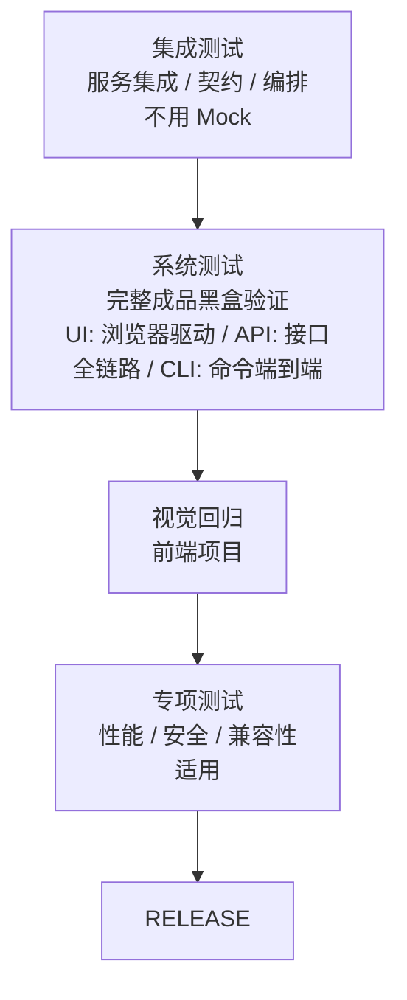

# SYSTEM_TEST 阶段

## 流程

SYSTEM_TEST 在 `develop` 分支上执行系统级验证——集成测试、系统测试、专项测试。单元测试和开发集成自测已在 DEVELOP 阶段完成，不在此重复。禁止新增功能代码。修复 bug 使用 `fix/*` 分支。



## 子阶段

### 集成测试（必选，所有项目）

按层级顺序执行，不可跳过。具体命令见 CONTRIBUTING.md 或项目测试脚本配置：

```
1. 服务集成测试（跨模块/跨服务，不用 Mock）
2. 接口契约测试（如果有）
3. 接口编排测试（如果有）
```

每层通过后才进入下一层。

### 系统测试（必选，所有项目）

完整成品黑盒验证，确认整体功能符合 AC 验收标准。按项目类型选择驱动方式：

| 项目类型 | 驱动方式 | 典型工具 |
|---------|---------|---------|
| UI 项目 | 浏览器驱动 E2E | Playwright, Cypress |
| API/服务项目 | 接口全链路调用 | HTTP 客户端 + 断言 |
| CLI 工具 | 命令端到端执行 | 进程启动 + 输出断言 |

### 视觉回归（适用：前端项目）

UI 截图比对，确认视觉无回退。

### 付费外部依赖验证 `[适用]`

当外部依赖涉及按量计费、配额消耗、付费调用时（免费除外），系统测试中的完整成品黑盒验证使用 TEST_INFRA 阶段配置的沙箱账号，低频手动触发：

- 使用隔离沙箱账号执行完整链路验证，确认付费依赖集成正确
- 沙箱验证不纳入 CI 流水线循环回归，仅在版本发布前手动执行一次
- 验证前确认沙箱账号用量告警和硬上限正常
- 验证范围：正常调用链路 + 异常/超时/错误码处理（Mock 替身已覆盖的 CI 高频部分不再重复）

**注意：** CI 高频回归中的付费依赖覆盖由 Mock 替身完成（见 TEST_INFRA 阶段），沙箱验证仅做环境兼容性确认，不重复验证所有场景。

### 专项测试（适用：有性能/安全要求的项目）

专项测试的验收标准在 DESIGN 阶段已写入 Spec 非功能指标和 AC 文档。工具选型在 TEST_INFRA 阶段 ADR 已确定。**执行脚本依赖真实部署环境，等系统测试功能自动化验证稳定后才编写和执行。**

每项产出独立 Report。

**性能测试：**

- 负载测试：逐步加压至目标并发，记录响应时间和错误率，对照 Spec 非功能指标
- 压力测试：超过目标并发，确认系统降级而非崩溃
- 基准对比：对比上版本指标，确认无性能回退

**安全测试：**

- 依赖漏洞扫描：确认 CI 已覆盖（MR 门禁 SAST），无遗漏
- 渗透测试：OWASP Top 10 基础检查
- 敏感信息泄露：检查日志、响应头、错误页面

**兼容性测试：**

- 浏览器兼容（前端项目）
- API 版本兼容（有 API 版本管理的项目）

**执行边界：**

- 你必须做：确认所有 Plan 已 done、按层级顺序执行全量测试、失败时提取失败用例名/失败断言/截图路径、全部通过后生成测试报告
- 你必须不做：不新增功能代码、不修改 Spec 或 ADR。基建缺陷退回 TEST_INFRA，设计缺陷退回 DESIGN

### 修复循环（适用：测试失败时）

修复在 SYSTEM_TEST 内部完成——不退回 DEVELOP。

每层失败时：
1. 停止，不继续下一层
2. 提取失败信息：失败用例名、失败断言、截图路径
3. 在 SYSTEM_TEST 内修复 bug（创建 `fix/*` 分支，修复后合并到 `develop`）
4. 修复完成后，重新从失败的那层开始执行

**失败分类判定表（Agent 判断）：** 每个失败必须先分类再处理。判定结论 + 依据写入测试报告（见 SKILL.md「Agent 判断必须可审计」）：

| 症状 | 分类 | 去向 |
|------|------|------|
| 门禁未拦截应拦截的提交、覆盖率数据错乱、Mock 返回与接口定义不符、测试框架不稳定（随机失败/环境抖动） | 基建缺陷 | 退回 TEST_INFRA（见 SKILL.md「基建修复」） |
| 实现符合契约但行为不符合真实需求：AC 场景错漏、Spec 业务规则错误、接口定义与需求不符 | 设计缺陷 | 退回 DESIGN（见 SKILL.md「设计缺陷」） |
| 其余：实现与契约不符 | 局部 bug | SYSTEM_TEST 内 `fix/*` 修复 |

修复规则：
- 只修 bug，不新增功能
- 修复前先写最小复现测试（修复前红、修复后绿），永久保留并标注来源（见 phase-develop.md「缺陷修复的测试约定」）
- 修复完成后重新执行全量测试（从失败层开始，已通过的层不重复执行——见 SKILL.md「测试执行边界」）
- 分类为基建缺陷 → 更新 `docs/README.md` 当前阶段为 TEST_INFRA，提交
- 分类为设计缺陷 → 更新 `docs/README.md` 当前阶段为 DESIGN，提交

**提示：** 定位回归 bug 时，可用 `git bisect` 二分查找引入 bug 的 commit。

## 阻塞级缺陷判定（Agent 判断）

推进到 RELEASE 前，对全部已知缺陷（含测试暴露但降级处理的问题）逐条判定。满足任一条即为**阻塞级**，不得推进：

- 核心用户故事不可完成（对照 Spec 用户故事优先级）
- 数据损坏或丢失
- 安全问题（越权、泄露、注入）
- 功能失效且无 workaround

其余为非阻塞——录入 `docs/backlog.md`（标注来源），不阻塞推进。拿不准的缺陷作为确认简报的问题提交人类（附建议判定）。判定结论 + 依据写入测试报告。

## 推进到 RELEASE

全部测试通过、无阻塞级缺陷后：更新 `docs/README.md` 当前阶段为 RELEASE，提交。约定前缀 `docs(state):`。`develop` 即为待发布状态。

## 输出格式（示例）

测试摘要（不要输出完整日志）：

```markdown
| 测试层 | 通过/总数 | 失败用例 | 耗时 |
|--------|----------|----------|------|
| 服务集成测试 | 5/5 | — | 4.1s |
| 系统测试 | 2/3 | AC-0007 (选择器超时) | 15.8s |

结论: [FAIL] 未通过 / [PASS] 全部通过
```
