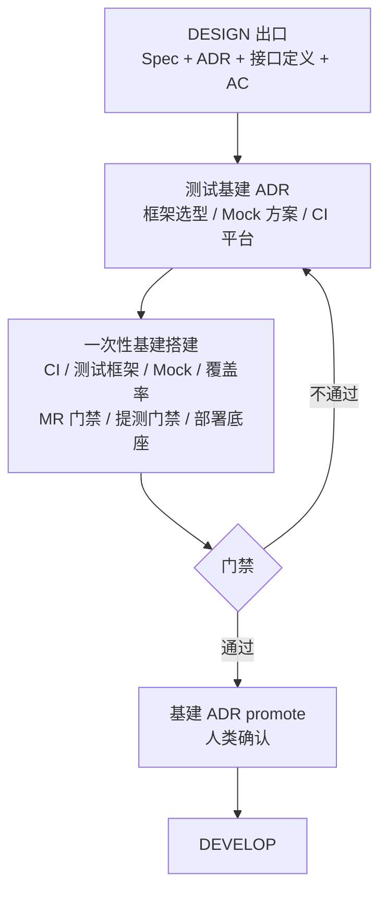

# TEST_INFRA 阶段

## 流程

TEST_INFRA 是 DESIGN 契约冻结后的第一个执行阶段。职责是设计并搭建一次性基建——CI 流水线、测试框架、Mock 服务、覆盖率采集、测试数据工厂、MR 门禁、质量门禁、提测门禁、部署底座——为 DEVELOP 阶段的业务开发提供可验证的环境。系统测试框架 `[适用]`、契约测试框架 `[适用]` 按项目类型决定。付费外部依赖的 Mock 替身和沙箱账号在此阶段搭建。

分支类型：`ci/*` `test/*` `build/*`，从 `develop` 拉出，合并到 `develop` 后删除。

进入 TEST_INFRA 后先做测试基建设计（轻量，仅 ADR），再创建执行容器、搭建基建。

**非首次迭代不重复搭建。** 增量迭代进入 TEST_INFRA 时既有基建已就绪，先走「增量检查」（见下），只补缺口；从 SYSTEM_TEST 因基建缺陷退回时走增量修复（见 SKILL.md「基建修复」）。本文档的搭建流程完整走一遍仅适用于**首次**进入 TEST_INFRA。

## 子阶段

### 测试基建设计

轻量设计，仅产出 ADR，不需要 vision/Spec/AC。基于 DESIGN 出口的 Spec + 接口定义 + 业务 ADR 确定测试基建的技术选型。

**需要决策的 ADR：**

| ADR | 决策内容 | 触发条件 |
|-----|---------|---------|
| 测试框架选型 | 单元测试框架 | 所有项目 |
| Mock 方案 | Mock 策略和工具 | 有外部依赖的项目 |
| 付费依赖隔离方案 | 付费资源 Mock 替身 + 沙箱账号策略 | 有按量计费/配额消耗/付费调用的项目 |
| 系统测试框架选型 | 系统测试框架 | 所有项目 |
| 视觉回归框架选型 | 视觉回归框架 | 前端项目 |
| CI 平台 | CI 平台选型 | 所有项目 |
| 覆盖率工具 | 覆盖率采集工具 | 所有项目 |
| 质量门禁选型 | 过程坏味道检查工具（复杂度/重复代码/文件大小）+ 阈值 | 所有项目 |
| 架构约束规则 | 架构规则检查工具（模块边界/依赖方向/分层） | 多模块/多服务项目 |
| 测试数据策略 | 测试数据管理方案 | 有持久化的项目 |
| 部署策略 | 部署平台和方式 | 所有项目 |
| 专项测试工具 | 性能/安全/兼容性测试工具 | 有性能/安全要求的项目 |

ADR 与业务 ADR 放在同一目录 `docs/adr/`，按编号递增。格式同业务 ADR（含验证段）。

**退出条件：** 上述 ADR 全部 status=proposed（验证段可为空——基建搭建 + 自证即为验证，自证通过后回填验证段并 promote，见「推进到 DEVELOP」）。

### 一次性基建搭建

测试基建设计完成后，在 `docs/plans/` 下创建执行容器。

职责是**搭建武器工厂，不是制造武器**——具体测试用例由开发者在 DEVELOP 阶段各自 Plan 中编写。

#### 1. 确定测试层级

根据项目类型确定需要的测试层。以下为常见参考，项目自行组合：

| 测试层 | 适用条件 | 说明 |
|--------|---------|------|
| 单元测试 | 所有项目 | 函数/方法/类内部逻辑 |
| 集成测试 | 所有项目 | 模块间协作 |
| 契约测试 | 前后端/服务间 | 接口契约一致性 |
| 系统测试 | 所有项目 | 完整成品黑盒验证。UI 项目浏览器驱动，API/服务接口全链路，CLI 命令端到端 |
| 视觉回归 | 前端项目 | UI 截图比对 |

#### 2. 搭建测试框架

- 安装测试框架
- 创建测试目录结构
- 配置测试脚本（每个测试层一个入口）
- 将测试命令和测试目录写入 CONTRIBUTING.md

#### 3. 搭建系统测试框架

系统测试框架按项目类型选择驱动方式：

- **UI 项目**：配置浏览器驱动 E2E 框架（Playwright/Cypress），截图、trace
- **API/服务项目**：配置接口全链路测试框架（HTTP 客户端 + 断言）
- **CLI 工具**：配置命令端到端执行框架（进程启动 + 输出断言）

所有项目类型：编写测试辅助工具（测试账号、测试数据、环境变量），确保框架可成功启动（即使测试用例为空）。

#### 4. 配置 CI 流水线

- 配置 CI，每次提交自动运行构建和测试
- 确保 CI 环境可运行测试框架

#### 5. 配置 MR 门禁

- 配置 CI 在 MR 提交时自动运行：单元测试 + 开发集成自测。契约测试 `[适用]`
- 设置通过条件：全部测试层通过 + 覆盖率达标 + 质量门禁通过
- 验证 MR 门禁可触发（提交占位 MR，确认流水线启动）

#### 6. 配置质量门禁

功能正确性有测试和编译器闭环，架构与代码质量约束必须同样机器化，否则冻结的 ADR 对代码没有强制力。质量门禁作为 MR 门禁的组成部分运行：

**过程层（所有项目）：**

- 按质量门禁 ADR 选型配置检查工具，覆盖：函数长度、圈复杂度、嵌套深度、重复代码、文件大小
- 优先 CLI + 结构化输出的工具（语言原生 linter、lizard、jscpd 等），便于 Agent 在循环中读取反馈并修复
- 阈值保守起步（宁松勿紧），防止 Agent 陷入追逐 lint 警告的噪音循环

**架构层 `[适用：多模块/多服务]`：**

- 从 accepted ADR（架构模式、分层规则）和 Spec 模块划分表（目录路径、数据实体所有权、依赖方向）导出架构规则文件（如 dependency-cruiser/import-linter/ArchUnit/deptrac 的规则配置）
- 规则文件是契约的机器可执行形式：模块边界、依赖方向、禁止跨层引用
- 契约变更（退回 DESIGN 修订 ADR/Spec）后必须同步更新规则文件

#### 7. 配置提测门禁

- 配置提测检查脚本：Report 完整性、AC 验收标注、覆盖率检查
- 验证提测门禁脚本可执行

#### 8. 配置部署底座

按 AGENTS.md 项目形态档案实例化（见 SKILL.md「门禁不可跳过，但可实例化」）：服务型搭建部署平台；发布型的部署底座为 publish 流水线（打包 → dry-run/测试源发布 → 安装验证）；本地型豁免此步。

搭建部署平台，所有服务复用。具体服务的部署配置（构建命令、环境配置、部署描述）由 DEVELOP 阶段各 Plan 自行编写。

- 配置 CI/CD 流水线框架（打包 → 部署 → 冒烟测试）
- 配置部署平台（容器注册中心、k8s namespace 等，按项目实际选择）
- 用一个占位服务验证部署链路可通（部署成功且冒烟通过）

#### 9. 付费外部依赖隔离 `[适用]`

当外部依赖涉及按量计费、配额消耗、付费调用时（免费除外），在 TEST_INFRA 阶段搭建隔离基础设施：

**Mock 替身：**

- 为付费外部依赖构建录制/回放替身（基于接口定义），用于 CI 高频回归
- 替身必须覆盖：正常响应、异常响应、超时、错误码
- 验证替身返回结构与接口定义一致（字段名、类型、错误码）

**沙箱账号：**

- 申请/配置隔离沙箱账号（独立的付费资源配额），用于 Staging 低频验收
- 沙箱账号不纳入 CI 流水线，仅 SYSTEM_TEST 阶段手动触发使用
- 设置沙箱账号的用量告警和硬上限，防止意外消耗

**禁止规则：**

- 扣费类外部调用禁止放入高频自动化流水线（CI/MR 门禁）
- Mock 替身是 CI 流水线中付费依赖的唯一合法替代

#### 10. 自证

在接入真实业务前，验证基建能正确判断对错，而非仅能启动：

- MR 门禁：提交故意失败的测试，确认 CI 报红阻断合并
- 质量门禁（过程层）：提交一段故意超阈值的代码（超长函数/深嵌套/复制粘贴块），确认被拦截
- 质量门禁（架构层）`[适用]`：提交一段故意违反模块边界的引用（跨层 import/直接访问他模块数据实体），确认被拦截
- 提测门禁：构造不达标的 Report（覆盖率不足/AC 未标注），确认门禁阻断
- Mock：对照接口定义验证返回结构（字段名、类型、错误码）
- 覆盖率：用已知代码基线跑，确认采集数据与人工统计一致
- 系统测试脚本 `[适用]`：逐条对照 AC 四场景静态检查，确认覆盖完整、断言精准、入参/错误码与接口定义一致
- 付费依赖 Mock 替身 `[适用]`：对照接口定义验证替身返回结构（字段名、类型、错误码），确认正常/异常/超时/错误码四类响应均可触发

**执行边界：**

- 你必须做：搭建测试框架、配置 CI 流水线、配置 MR 门禁/质量门禁/提测门禁、配置部署底座、自证基建能正确判断对错。系统测试框架 `[适用]`、契约测试 `[适用]`、付费依赖隔离 `[适用]`、架构约束规则 `[适用]`
- 你必须不做：不编写具体测试用例（属于 DEVELOP 阶段职责）、不编写业务代码、不修改 Spec 或业务 ADR（测试基建 ADR 仅允许回填验证段）、不推进系统状态

## 增量检查（非首次迭代）

增量迭代进入 TEST_INFRA 时，先对照本轮 DESIGN 增量（新增模块/AC/ADR）检查既有基建，只补缺口：

| 检查项 | 检查方法 | 不满足时 |
|--------|---------|---------|
| 既有测试基建 ADR 覆盖本轮需求 | 对照本轮新增模块和测试层需求，逐 ADR 核对决策范围 | 新增测试基建 ADR（不修改已 accepted 的） |
| 测试框架/Mock 支持新增模块 | 检查新增模块所需测试层入口、Mock 配置是否已存在 | 增量搭建对应组件 |
| 架构规则文件与最新契约一致 `[适用]` | 对照本轮新增/修订的 ADR 和 Spec 模块划分 | 更新规则文件 |
| CI/门禁仍正常 | 触发一次 CI 确认全绿；核对门禁配置无漂移 | 修复 |

- 检查全过且无增量需求 → 直接推进 DEVELOP，不重复走全量门禁自证
- 有增量搭建 → 仅对**新增组件**走对应门禁项自证（"正确拦截"类只验证新增规则），已自证过的既有基建不重跑
- 检查结论 + 依据写入本轮执行容器 Report（见 SKILL.md「Agent 判断必须可审计」）

## 门禁

以下门禁完整适用于首次搭建；增量迭代仅适用与本轮增量相关的行（见「增量检查」）：

| 审查内容 | 审查方法 |
|---------|---------|
| 测试基建 ADR 全部 proposed 且验证段已回填（自证结果） | 逐 ADR 检查 frontmatter status + 验证段非空 |
| CONTRIBUTING.md 测试段已填写 | 检查测试命令和测试目录段非空 |
| CI 流水线可运行 | 触发一次 CI，确认构建和测试脚本可执行 |
| MR 门禁正确拦截 | 提交一个故意失败的测试，确认 CI 报红阻断合并 |
| 质量门禁正确拦截（过程层） | 提交超阈值代码（超长函数/深嵌套/重复块），确认被拦截 |
| 质量门禁正确拦截（架构层）`[适用]` | 提交违反模块边界的引用，确认被拦截 |
| 架构规则文件与契约一致 `[适用]` | 对照 accepted ADR 和 Spec 模块划分表，逐条核对规则文件的边界/依赖方向定义 |
| 提测门禁正确拦截 | 构造不达标的 Report（覆盖率不足/AC 未标注），确认门禁阻断 |
| 部署底座可通（按形态实例化，本地型豁免） | 占位服务部署成功且冒烟测试通过；发布型为 dry-run 发布 + 安装验证通过 |
| Mock 返回正确 | 对照接口定义验证 Mock 返回结构（字段名、类型、错误码） |
| 付费依赖 Mock 替身正确 `[适用]` | 对照接口定义验证替身返回结构，确认正常/异常/超时/错误码四类响应均可触发 |
| 沙箱账号已配置 `[适用]` | 确认沙箱账号可用、用量告警和硬上限已设置 |
| 覆盖率数据准确 | 用已知代码基线跑，确认采集数据与人工统计一致 |
| 系统测试框架可跑冒烟 | 运行一个占位用例，确认框架启动成功（UI 项目浏览器驱动，API/CLI 项目对应驱动方式） |
| 系统测试脚本对齐 AC | 静态检查：逐条 AC 核对四场景是否覆盖，断言是否精准，入参/错误码是否与接口定义一致 |
| 所有执行容器已创建 | 逐容器检查 README.md 存在 |
| 一次性基建 Plan 全部 done | 检查 Plan README 状态表 |

## 推进到 DEVELOP

全部基建 Plan 分支合并到 `develop`，`develop` CI 全绿后：

1. 提交确认简报（见 SKILL.md「向上汇报原则」），人类确认后 promote 测试基建 ADR `proposed → accepted`，独立 commit。增量迭代仅 promote 本轮**新增**的测试基建 ADR，无新增则跳过此步
2. 更新 `docs/README.md` 当前阶段为 DEVELOP，提交。约定前缀 `docs(state):`

## 参考实现

以下为示例，按项目类型裁剪。

### 全栈 Web 项目（示例）

CI 流水线 + 部署底座 + 测试框架 + Mock 服务 + 契约测试框架 + 系统测试框架 + 覆盖率配置 + 测试数据工厂 + MR 门禁 + 质量门禁 + 提测门禁

### CLI 工具项目（示例）

CI 流水线 + 部署底座 + 测试框架 + 系统测试框架 + 覆盖率配置 + 测试数据工厂 + MR 门禁 + 质量门禁 + 提测门禁

### 前端组件库项目（示例）

CI 流水线 + 部署底座 + 测试框架 + 组件测试框架 + 视觉回归框架 + 覆盖率配置 + MR 门禁 + 质量门禁 + 提测门禁
